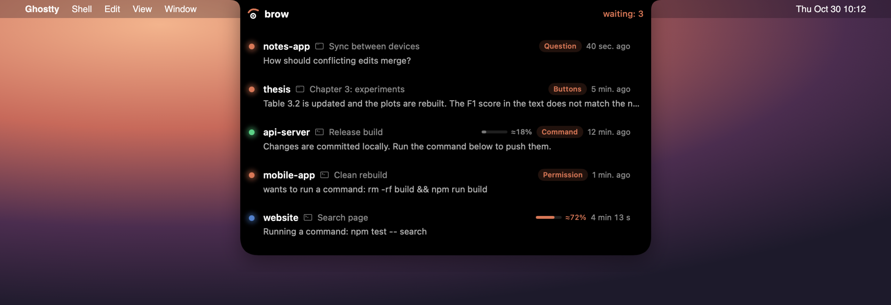
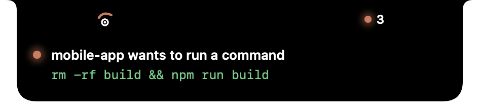
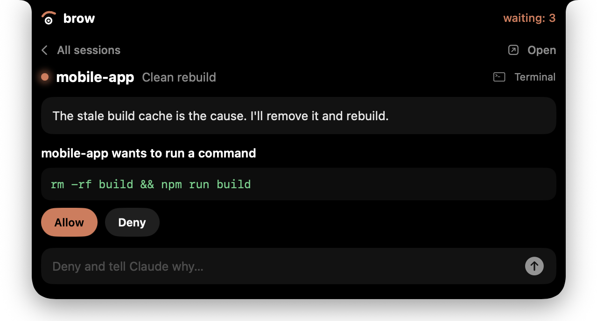
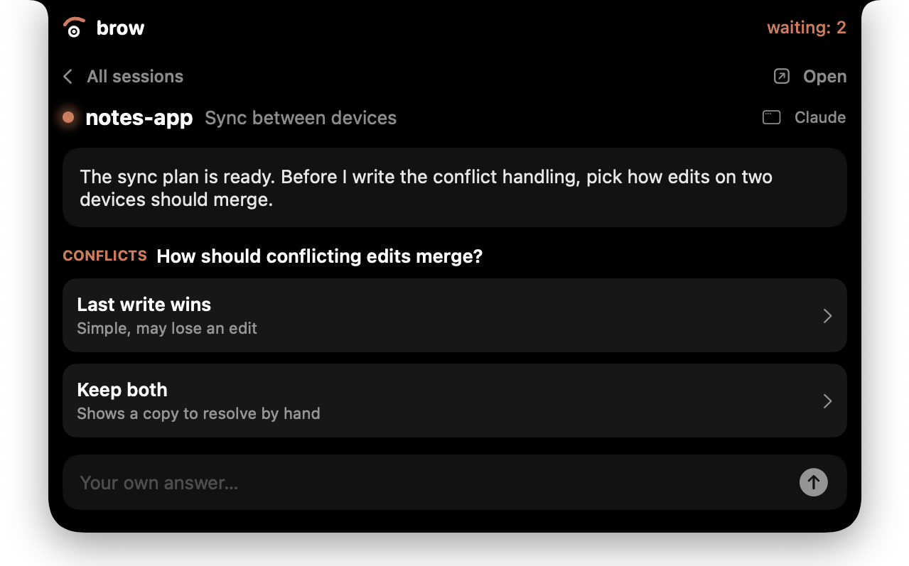
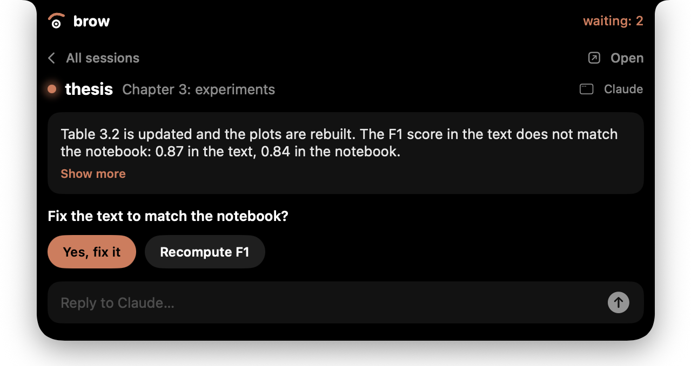
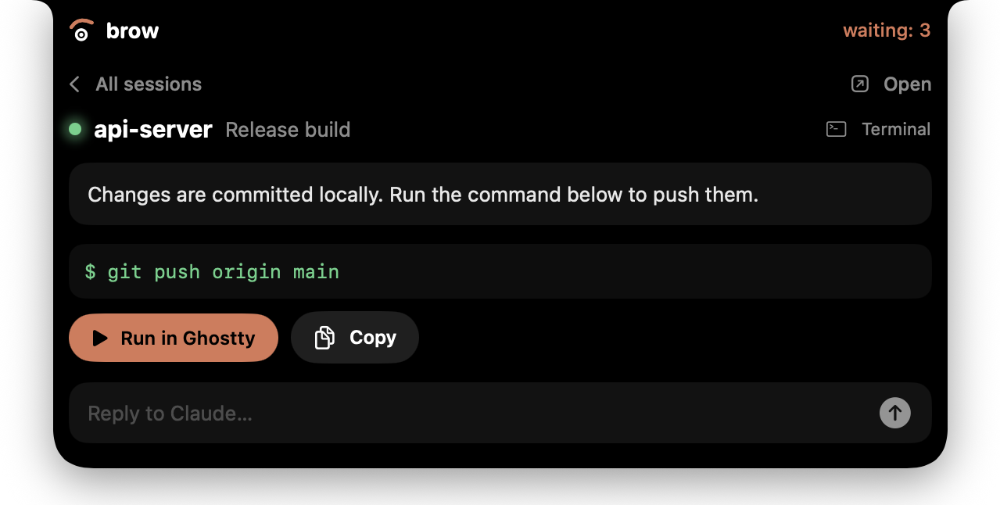
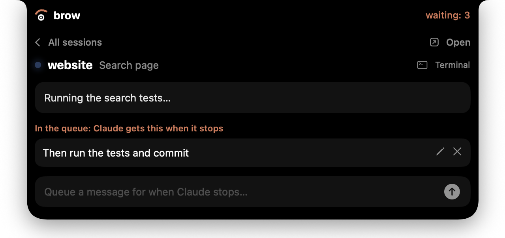

# brow

**Your Claude Code sessions, in the MacBook notch.**



brow lives in the notch and shows where each Claude Code session stands: which one is still working, which one finished, and which one is waiting for you. Expand it to read the last message and answer right there — type a reply, press one of the buttons Claude suggested, pick an option in a question, or run the command Claude proposed. It works with both the Claude desktop app and `claude` in the terminal.

[Українською](README.uk.md)

## Features

- **Every session at a glance.** The closed notch shows how many sessions are waiting for you; hover to see them all with their project, title, state and last message.
- **Live activity.** A working session shows what Claude is doing right now and for how long: `Running a command: npm test · 4 min 12 s`. Hide the command text from the menu if your screen is visible to others.
- **Context at a glance.** A small bar on each session shows how full its context is, turning orange at 70% and red at 90%, when the notch warns once. The session card adds the token counts.
- **Alerts you can't miss.** When a session starts waiting, the notch slides down for four seconds and says who needs what. Hover to answer, or ignore it and it tucks away. An optional sound is in the menu. No alert for a session whose app is already in front.
- **Reply from the notch.** What you type reaches Claude as your next message.
- **Queue the next step.** While Claude works, write what it should do next. It gets the message the moment it stops, so you can line up work across sessions and walk away.
- **Permissions from the notch.** When Claude asks to run a command or change a file, see exactly what it wants and press Allow or Deny, or type why not. Nothing is ever approved on its own.
- **Buttons and questions.** The buttons at the end of a reply in the desktop app, and multiple-choice questions (one or several, multi-select or your own answer), work from the notch.
- **Run suggested commands.** A shell block in Claude's message gets a button that opens it in a new [Ghostty](https://ghostty.org) window, in the session's folder. Nothing runs until you click.
- **Stays out of the way.** No Dock icon, no CPU when idle, and if brow is not running Claude behaves exactly as before.
- English and Ukrainian, following the system language.



| Permission | Question |
|---|---|
|  |  |

| Buttons | Command |
|---|---|
|  |  |

| Queue |
|---|
|  |

## Requirements

- macOS 14 Sonoma or later. Made for MacBooks with a notch; on other screens brow shows the same pill at the top centre.
- [Claude Code](https://claude.com/claude-code): the desktop app or the CLI.
- To build: Xcode or the Command Line Tools (Swift 5.10+).
- Optional: Ghostty, for running suggested commands.

## Install

```bash
git clone https://github.com/dmytrosydor/brow.git
cd brow/app
scripts/install.sh
```

This builds `brow.app`, copies it to `/Applications` and starts it. On first launch the notch slides down and offers to connect (later: **right-click the notch → Connect to all Claude sessions…**). brow shows exactly what it will add to `~/.claude/settings.json` and keeps a copy of the old file next to it.

A prebuilt `brow.app` is attached to each [release](https://github.com/dmytrosydor/brow/releases). It is not notarized by Apple, so after unzipping it into `/Applications` run `xattr -dr com.apple.quarantine /Applications/brow.app` once, or macOS will refuse to open it.

## How it works

```
Claude (app or terminal) ──hook──▶ brow-hook ──Unix socket──▶ brow (notch)
          ▲                                                       │
          └──────────── your reply / answer ◀──────────────────────┘
```

brow adds one small command, `brow-hook`, to Claude Code's [hooks](https://docs.claude.com/en/docs/claude-code/hooks) for these events: `SessionStart`, `UserPromptSubmit`, `Stop`, `Notification`, `SessionEnd`, `PreToolUse`, `PostToolUse`/`PostToolUseFailure` and `PermissionRequest`. The hook passes each event to brow over a socket in `~/Library/Application Support/brow/`.

To get a reply back to Claude, brow briefly **holds** the session:

- When Claude stops and that session's window is not in front, the `Stop` hook waits. Your reply is returned as `{"decision": "block", "reason": …}`, which Claude reads as your next message.
- A queued message is returned the same way at the next `Stop`, whichever app is in front.
- A multiple-choice question is answered through `PermissionRequest` with `updatedInput.answers`. The app shows its own dialog meanwhile; whichever answers first wins.
- A permission request is answered the same way, with `behavior: allow` or `deny`. Your app or terminal shows its usual prompt meanwhile, and the first answer wins.
- A hold ends without a reply as soon as you switch to that app or type there, the session ends, it times out (10 minutes by default) or brow quits.

While a session is held, the Claude desktop app shows it as still running. Switch to the app and it is let go at once.

## Old sessions

A killed terminal or a sleeping Mac tells brow nothing, so it goes by silence. A session marked as working turns gray after 30 minutes without events and comes back with its next one. Any session disappears after 6 hours without events, unless it has queued messages. Hover a row and press × to remove it yourself.

## Settings

Right-click the notch:

- **Hold sessions for replies from the notch** — turn holding off to use brow only as a status display.
- **Wait for a reply** — 5, 10, 20 or 30 minutes.
- **Show the text of what Claude runs** — off shows only the kind of action, in case commands carry secrets.
- **Show alerts when a session waits** and **Alert sound**.
- **Open at login.**
- **Connect to / Disconnect from all Claude sessions.**
- **Quit brow.**

To never hold a particular session, put its id on its own line in `~/Library/Application Support/brow/skip_sessions`.

## Privacy and safety

- Everything stays on your Mac. brow makes no network requests. It reads session transcripts only for token counts.
- The socket is readable only by your user.
- Commands run only when you press the button, in a new terminal window where you can see them.
- `brow-hook` never blocks Claude when brow is not running: it exits immediately and prints nothing.

## Uninstall

Right-click the notch → **Disconnect from all Claude sessions…**, quit brow and delete `/Applications/brow.app`. Or from the terminal:

```bash
/Applications/brow.app/Contents/MacOS/brow --uninstall-hooks
```

## Known limitations

- Not notarized: see the note under Install.
- Typing in the desktop app while brow holds that session has not been tested much; brow lets the session go as soon as the app comes to the front.
- After a reply from the notch, the desktop app may still draw the old buttons under the message.
- Refusing a permission in the app or terminal sends brow no event, so its card stays until Claude reports the session idle, about a minute later. Pressing a button on it in that minute does nothing.
- The context bar is an estimate. Hooks and transcripts do not state the window size, so brow assumes 1M for an explicit `[1m]`, for Opus and past 200K, and 200K otherwise. On a plan where Opus has 200K it reads low. It also relies on Claude Code's transcript format; if that changes, the bar just disappears.
- The queue lives in memory: quitting brow loses it. A permission prompt or question does not use it, Claude waits for your answer first.
- Clicking **Open** brings the right app forward, but not the exact session.
- Sessions that were already running when brow started appear after their next event.

## Contributing

See [CONTRIBUTING.md](CONTRIBUTING.md). The design notes are in [docs/PLAN.md](docs/PLAN.md), and [spike/](spike/) has the experiments that proved the idea.

## License

[MIT](LICENSE) © 2026 Dmytro Sydor
